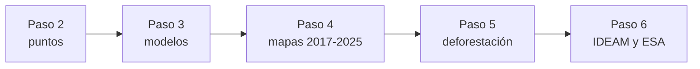

# Deforestación en el Huila 2017–2025

Modelo de clasificación **bosque / no bosque** con Machine Learning y los embeddings de
**Google AlphaEarth Foundations (GAEF)** para analizar la deforestación en el Huila entre 2017 y
2025. Trabajo de grado de Paulina, Universidad de Manizales.

> **Este repositorio tiene solo el código.** Los datos (embeddings de AlphaEarth, ESA WorldCover,
> IDEAM e hidrografía; ≈ 50 GB) y los resultados (mapas `.tif`, modelos, tablas) **no están en
> GitHub** porque son muy pesados. Se bajan del Drive como dice la sección
> [Datos](#datos-no-incluidos-en-el-repositorio).

## Cómo funciona

1. AlphaEarth resume cada píxel de 10 m, para cada año, en 64 números (el *embedding*).
2. Se toman puntos donde ESA WorldCover, IDEAM y Dynamic World coinciden en que hay o no hay
   bosque, y se leen sus 64 números.
3. Se entrenan Random Forest, SVM y XGBoost, y se elige el mejor.
4. Con ese modelo se hace un mapa de bosque de cada año, sin el agua.
5. Comparando años seguidos se calcula la deforestación y se separan los cambios espurios.
6. Los mapas se comparan con IDEAM y ESA.



Más diagramas en [docs/diagramas.md](docs/diagramas.md).

## Archivos

| Archivo | Qué hace | Objetivo específico |
|---|---|---|
| [configuracion.py](configuracion.py) | Carpetas, años y parámetros. **Es el único que se edita.** | |
| [paso1_revisar_datos.py](paso1_revisar_datos.py) | Dice qué datos están y cuáles faltan | |
| [paso2_muestras.py](paso2_muestras.py) | Puntos etiquetados con ESA, IDEAM y Dynamic World, con sus embeddings y su bloque de 10 km | 1 |
| [paso3_entrenar_modelos.py](paso3_entrenar_modelos.py) | Entrena RF, SVM y XGBoost; matriz de confusión, exactitud, kappa, F1, precisión, sensibilidad, especificidad y AUC | 2, 3 |
| [paso4_mapas_bosque.py](paso4_mapas_bosque.py) | Mapa de bosque de cada año con máscara de agua e hidrografía | 5 |
| [paso5_deforestacion.py](paso5_deforestacion.py) | Deforestación por año, cambios espurios, mapa del año de pérdida y mapa de calor | 4 |
| [paso6_comparar_referencias.py](paso6_comparar_referencias.py) | Concordancia de los mapas con IDEAM y ESA | 3, 4 |
| [utilidades.py](utilidades.py) | Tres funciones que usan varios pasos | |

El objetivo 6 (lineamientos) se escribe a partir de los resultados del paso 5.

## Instalar (una vez)

```bash
brew install uv rclone
```

```bash
uv sync
```

Earth Engine (para Dynamic World en el paso 2); se abre el navegador para autorizar:

```bash
uv run earthengine authenticate
```

## Datos (no incluidos en el repositorio)

Los datos viven en la carpeta compartida **APLICACIONES SIG** de Google Drive (pedir acceso a
Paulina). El código los busca en la carpeta `datos.nosync/`, dentro de este proyecto, que
[`.gitignore`](.gitignore) deja por fuera de GitHub. El nombre termina en `.nosync` para que
iCloud tampoco intente subirlos. Si los datos están en otro lugar, se cambia `CARPETA_DATOS` en
[configuracion.py](configuracion.py).

Estructura que espera el código:

```
datos.nosync/
├── DATOS/
│   ├── embeddings/2017 … 2025/          81 teselas .tif por año (≈ 25 GB por año)
│   ├── clases_esa/                      esa_wc_huila_2020.tif, esa_wc_huila_2021.tif
│   ├── INVENTARIO FORESTAL/             mapas del IDEAM 2017, 2017-2018 y 2019
│   ├── DRENAJE_DOBLE/drenaje_doble.shp
│   └── EMBALSE/embalse.shp
└── resultados_deforestacion/            lo crea el código
```

Para bajarlos se usa [rclone](https://rclone.org). Los comandos se corren desde la carpeta del
proyecto. Primero se conecta rclone con la carpeta del Drive (una vez; se abre el navegador para
autorizar). `ID_DE_LA_CARPETA` es la parte final del enlace de la carpeta en el Drive
(`https://drive.google.com/drive/folders/ID_DE_LA_CARPETA`):

```bash
rclone config create paulina drive scope=drive.readonly root_folder_id=ID_DE_LA_CARPETA
```

ESA WorldCover, hidrografía e IDEAM (≈ 11 GB):

```bash
rclone copy paulina:DATOS "datos.nosync/DATOS" --include "clases_esa/**" --include "DRENAJE_DOBLE/**" --include "EMBALSE/**" --include "*BQNBQ_V7_2017*" --include "*BQNBQ_V8_2019*" --include "*CBBQ_V5_2017_2018*" -P
```

Embeddings de un año (≈ 27 GB; cambiar 2021 por el año):

```bash
rclone copy paulina:DATOS/embeddings/2021 "datos.nosync/DATOS/embeddings/2021" -P
```

## Correr

Desde la carpeta del proyecto, en orden:

```bash
uv run python paso1_revisar_datos.py
```

```bash
uv run python paso2_muestras.py
```

```bash
uv run python paso3_entrenar_modelos.py
```

```bash
uv run python paso4_mapas_bosque.py
```

```bash
uv run python paso5_deforestacion.py
```

```bash
uv run python paso6_comparar_referencias.py
```

El paso 2 tarda unos 2 minutos y el 3 menos de uno. El paso 4 tardó 22 minutos para 2021 con SVM
(medido en este Mac). Los resultados quedan en `datos.nosync/resultados_deforestacion/`.

### Todos los años

Los 9 años de embeddings ocupan ≈ 240 GB. Después de los pasos 2 y 3, este bloque baja un año, hace
su mapa y borra los embeddings de ese año (siguen en el Drive):

```bash
for anio in 2017 2018 2019 2020 2021 2022 2023 2024 2025; do
  rclone copy "paulina:DATOS/embeddings/$anio" "datos.nosync/DATOS/embeddings/$anio" -P &&
  uv run python paso4_mapas_bosque.py &&
  test -f "datos.nosync/resultados_deforestacion/mapas_bosque/bosque_$anio.tif" &&
  rm -r "datos.nosync/DATOS/embeddings/$anio"
done
```

## Resultados

| Archivo | Contenido |
|---|---|
| `muestras.csv` | Puntos con sus etiquetas (esa, ideam, dw), la final (bosque), el bloque y los 64 valores |
| `puntos_desacuerdo.csv` | Puntos descartados porque ESA e IDEAM no coincidían (se usan como prueba difícil) |
| `comparacion_modelos.csv` | Métricas de cada modelo en los bloques de prueba |
| `sobreajuste.csv` | Métricas en entrenamiento y en prueba, y la brecha entre ambas |
| `particiones_repetidas.csv` | AUC y kappa (media, desviación y mínimo) con 10 repartos distintos de bloques |
| `puntos_dificiles.csv` | Qué dice cada modelo en los puntos donde ESA e IDEAM no coinciden |
| `matrices_confusion.png`, `curvas_roc.png` | Matriz de confusión y curva ROC de cada modelo |
| `mapas_bosque/bosque_AAAA.tif` | 0 no bosque, 1 bosque, 2 agua, 255 sin dato |
| `deforestacion_por_anio.csv` | Hectáreas de bosque, cambios brutos, espurios y deforestación de cada año |
| `anio_perdida.tif` | Año en que cada píxel perdió el bosque (0 = no lo perdió) |
| `grafica_deforestacion.png`, `mapa_calor.png` | Evolución en el tiempo y focos de deforestación |
| `comparacion_referencias.csv` | Concordancia con IDEAM 2017 y 2019, ESA 2020 y 2021, y deforestación IDEAM 2017-2018 |

## Decisiones del método

* **Puntos puros:** solo píxeles cuyos 5 × 5 vecinos tienen la misma clase en ESA, para evitar
  bordes y mezclas.
* **Consenso de etiquetas:** se descartan los puntos en los que IDEAM o Dynamic World no están de
  acuerdo con ESA. Reduce el error de las etiquetas, pero deja fuera los casos difíciles; con
  `ETIQUETA_FINAL = "esa"` se usan todos.
* **IDEAM 2019 para etiquetar puntos de 2021:** el IDEAM llega hasta 2019. Si un punto cambió
  entre 2019 y 2021, el consenso lo descarta.
* **Bloques de 10 km:** entrenamiento y prueba se separan por bloques para que las métricas no
  salgan infladas por la cercanía entre puntos.
* **Un modelo de 2021 para todos los años:** AlphaEarth está hecho para que los embeddings de
  distintos años sean comparables. El paso 6 lo verifica contra IDEAM 2017 y 2019.
* **Cambios espurios:** un píxel que pasa a no bosque y al año siguiente vuelve a bosque se cuenta
  como espurio, no como deforestación.
* **Agua:** se enmascara el agua de ESA 2021, los ríos dobles y el embalse. Las quebradas
  (`drenaje_sencillo`, líneas) no, porque casi siempre pasan bajo el bosque.

## Prueba automática

Crea un Huila de mentira con un parche talado en 2019 y corre los seis pasos (≈ 30 s, sin Earth
Engine):

```bash
uv run pytest
```
